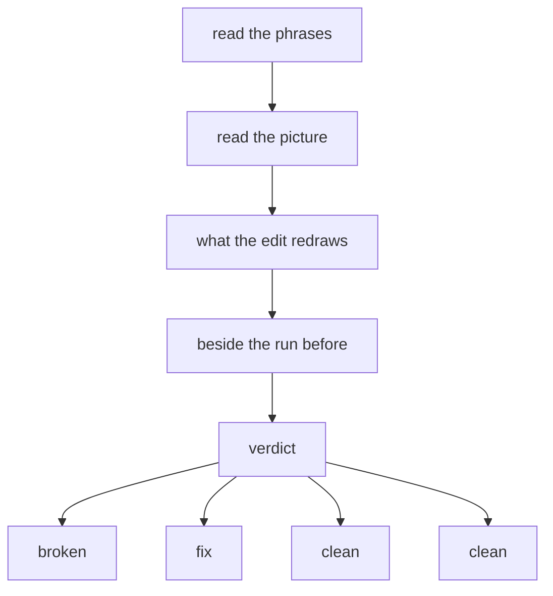

# check — the one call after an edit

`storyreel check` (and the MCP tool `check`) reads everything that can be read without rendering, once, and answers
in one reply:

```
fix 1 — 1 error
the whole film: 0.00–9.04 s of 9.04 s — read: under-captions, words-overlap, cut-off, …
fix  0:02.0–0:03.8 one · words over words: "Alpha" and "Beta"
not run · Drawn parts hold together: no kit on screen gives its parts (parts(t))
changes: 2 of 2 pieces changed (0:09 of 0:09)
since the run before: 1 fixed, 0 new · round 2
```

**Why.** An agent fixing a film called `anchors`, `timeline`, `review` and `changes` in turn, read four replies, and
had to work out itself what its last edit did. Each of those tools is still there for a closer look. A check says:

1. **The verdict, first line**: `clean`, `fix <n>` (n errors), or `broken` (the film does not compile, and why).
2. **What to fix, worst first**: errors (`fix`), then advice (`note`). The first 8; the rest are counted by
   kind, and `--full` lists them. A verdict that could not run is said (`not run`), never counted as passed.
3. **What the edit redraws**: the count `changes` gives.
4. **Since the run before**: how many of the last check's problems are gone, how many are new, and the round of
   fixing (1 after a clean check; one more each check that still has something to fix).

What counts as an error: a phrase the film is keyed to and cannot place, a verdict that failed, and every review
finding but the four that are advice (`still`, `stale`, `slideshow`, `hook`: a held title can be right). A phrase the
film still places (said twice: the first place is used) is advice.

## The chart

A check is a footprintjs flowchart, so its run says what it read and why it answered as it did (`storyreel log`
lists it; `storyreel log --run 1 --only decisions` shows the verdict's rule). Drawn from the chart itself
(`checkChart(...).toMermaid()`, pinned by `test/check.test.mjs`):



| file | one job |
|---|---|
| `index.mjs` | `checkFilm(does, options)`: runs the chart, returns the reply and what the log keeps |
| `chart.mjs` | the wiring, and nothing else |
| `stages.mjs` | what each stage does; the verdict's rules (`VERDICT_RULES`), decided with `decide()` |
| `problems.mjs` | the problems as one list (`problemsOf`), and one check beside the one before (`sinceLast`) |
| `text.mjs` | the reply (`checkText`) |

The work itself is given by the caller (`does`: `anchors`, `review`, `changes`, `before`), so this folder knows
nothing of a project's files: `tools.mjs · check` gives the project's, and a test gives fakes.

**Compared by what a problem is, not when.** A problem's key is a short hash of its sort, its scene and its words
with every number taken out: an edit that moves a finding two seconds later, or leaves it 71 % still where it was
72 %, has not fixed it. What the next check compares with (the film, the verdict, the round and the keys) is kept in
the check's own run (`runlog.mjs`), in the project's out folder. A film is compared with itself only: a project whose
flags pick another film (other scenes) starts its own count. Past 300 problems the counts are not said.

**One thing to fix is counted once.** A verdict that failed is one error, unless its own findings are listed as
errors (a verdict's findings carry its check's name): then they are what to fix.

**Broken, never thrown.** Whatever stops the film from compiling, as every other tool compiles it, is the `broken`
line. Only what is no film at all (no config, a config that throws) is an error of the command.

**Small whatever the film.** A row is cut at 300 characters, and the list at the first 8.

**What a film's files say stays on its row.** Every line of the reply that carries the film's own words is one line
(`../oneline.mjs`).
