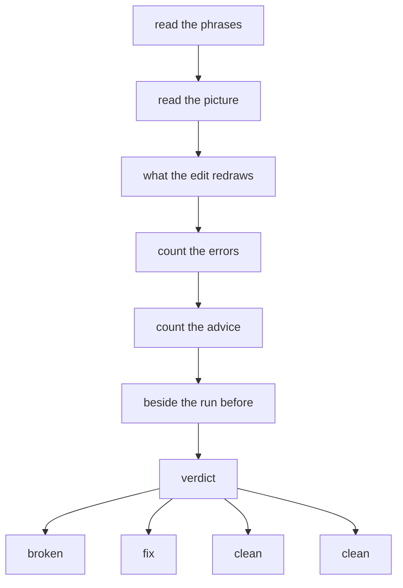

# check — the one call after an edit

`storyreel check` (and the MCP tool `check`) reads everything that can be read without rendering, once, and answers
in one reply:

```
fix 1 — 1 error
the whole film: 0.00–9.04 s of 9.04 s — read: under-captions, words-overlap, cut-off, …
fix  0:02.0–0:03.8 one · words over words: "Alpha" and "Beta" · at story · fix: move it 36 down, clear of "Alpha" (story)
not run · Drawn parts hold together: no kit on screen gives its parts (parts(t))
changes: 2 of 2 pieces changed (0:09 of 0:09)
since the run before: 1 fixed, 0 new · round 2
```

**Why.** An agent fixing a film called `anchors`, `timeline`, `review` and `changes` in turn, read four replies, and
had to work out itself what its last edit did. Each of those tools is still there for a closer look. A check says:

1. **The verdict, first line**: `clean`, `fix <n>` (n errors), or `broken` (the film does not compile, and why).
2. **What to fix, worst first**: errors (`fix`), then advice (`note`). The first 8; the rest are counted by
   kind, and `--full` lists them. A verdict that could not run is said (`not run`), never counted as passed. Each
   finding names the recipe entry it is about (`at story.items[1]`) and the one change that clears it (`fix: move it
   138 up: set x, y to (300, 422)`), so it can be acted on without looking at the picture (`../fix/README.md`).
3. **What the edit redraws**: the count `changes` gives.
4. **Since the run before**: how many of the last check's problems are gone, how many are new, and the round of
   fixing (1 after a clean check; one more each check that still has something to fix).

What counts as an error: a phrase the film is keyed to and cannot place, a verdict that failed, and every review
finding but the four that are advice (`still`, `stale`, `slideshow`, `hook`: a held title can be right). A phrase the
film still places (said twice: the first place is used) is advice.

## The chart

A check is a footprintjs flowchart, so its run says what it read and why it answered as it did (`storyreel log`
lists it; `storyreel log --run 1 --only decisions` shows the verdict's rule). Drawn from the chart itself
(`checkChart(...).toMermaid()`, pinned by `test/check.test.mjs`):



| file | one job |
|---|---|
| `index.mjs` | `checkFilm(does, options)`: runs the chart, returns the reply and what the log keeps |
| `chart.mjs` | the wiring, and nothing else |
| `stages.mjs` | what each stage does; the verdict's rules (`VERDICT_RULES`), decided with `decide()` |
| `problems.mjs` | the problems as one list (`problemsOf`), and one check beside the one before (`sinceLast`) |
| `text.mjs` | the reply (`checkText`) |
| `maps.mjs` | each isometric world's map built again by the map flow, its run's record kept (`runMaps`), and what the reply says of them (`mapLines`) |

The work itself is given by the caller (`does`: `anchors`, `review`, `changes`, `before`), so this folder knows
nothing of a project's files: `tools.mjs · check` gives the project's, and a test gives fakes.

**Compared by what a problem is, not when.** A problem's key is a short hash of its sort, its scene and its words,
without its times; where the words are a measurement the numbers are left out too. An edit that moves a finding two
seconds later, or leaves it 71 % still where it was 72 %, has not fixed it. What the next check compares with (the film, the verdict, the round and the keys) is kept in
the check's own run (`runlog.mjs`), in the project's out folder. A film is compared with itself only: the same
project with other flags (a config's `film(flags)` may give another film) starts its own count. Past 300 problems the counts are not said.

**One thing to fix is counted once.** A verdict that failed is one error, unless its own findings are listed as
errors (a verdict's findings carry its check's name): then they are what to fix.

## Asking why

A check keeps its record: a file beside its run in the out folder (`.storyreel/runs/<run>.record.jsonl`), written as
the check runs — every commit, the keys each stage had read when it wrote, and (in the run's own file) which decision
let each stage run. So a value can be asked for, and nothing is run again:

```
$ storyreel log --run 1 --why errors
errors = 1
count the errors (errors#3) [wrote: errors]
  read the phrases (phrases#0) ← via phraseErrors [wrote: phrasesChecked, phraseProblems, phraseErrors, …]
  read the picture (picture#1) ← via pictureErrors [wrote: reviewed, findings, pictureErrors, …]
(a stage also uses what it is given from outside the run's own state — the film, the check before: …)
```

`--why fixes` gives each finding's kind, recipe entry and fix as data, written by `read the picture`. `--why verdict` shows the branch that wrote it, the rule that chose the branch, and what that rule read. A value no
stage wrote is said so. The walk is foottrace's (`sliceForKey`), over the file alone (`../why.mjs`).

- **A cause shown is a read that happened.** Each count is added in a stage of its own (`count the errors`, `count the
  advice`) from what the stages before wrote, so the path the record holds is exact. What a stage is given from
  outside the run's own state (the film, the check before) is in no record: every answer ends by saying so, and
  `round` shows no cause for that reason.
- **The record is read as a file anyone may have written.** Only as a plain file of at most 8 MB, never through a
  link; it must hold one run; a name or a value in it starts no line of the answer; a step lists at most 200 rows and 200 keys read (more are cut,
  and the answer says so); a
  saved decision is used only when it names an earlier step of this record. A record that is not whole says so
  first, and then a value it lacks is "not found in what could be read".
- A record is removed with its run (the newest 50 checks are kept). One a killed check left pending is cleared by a
  later check, an hour on.

## Asking why a map is so

A film with isometric worlds (`../kits/isometric/`) has each world's map built twice: by the compile, with
footprint-story's `buildIsoMap`, to draw it; and by the check, with footprint-story's map flow (`runMapFlow`, a
footprintjs chart of the same steps), so a run's record holds a real run of them. Each map's run keeps its own record,
beside the check's: `.storyreel/runs/<run>.map-<k>.record.jsonl`, k its place in the run's list (a record holds one
run; a file is never named by a world's name). `--map` picks which record `--why` reads, by the world's place in the
recipe (`story`, `'stages[1]'` — quoted in a shell):

```
$ storyreel log --run 1 --why at --map story
at = [[1.5,16,0],[4.5,13,0],[10.5,6.5,0],[11.5,1.5,0],[16,6,0]]
place: build (build#2) [wrote: at]
  read (read#0) ← via who [wrote: who, blocks, floors, wires, written, area, style, policy]
    ⚠ also consumed args — slice may be incomplete here
  place (place#1) ← [control: no block has an at: the build places them from their wires, group by group (1 group)] [wrote: placed, placedWhy]
    ↳ read#0 (see above)
(a stage also uses what it is given from outside the run's own state: the record holds what stages read and wrote, and no more)
```

`--why view` answers through the grid's decision (`[control: no grid is written: it is fitted so the picture fills the
area]`), `--why names` through the names step (each name's lines and size), and a map placed by hand says so
(`place: hand … [control: every block has an at: the map placed them]`). The keys are the map steps' (a key no step
writes lists them). From a real run of `test/fixtures/iso-world`, pinned by `test/map-record.test.mjs`.

**Why a flag, not `--why story.at`.** `--why` names a value by its own name, as it always has; which record it reads
is another choice, so it has its own flag. **Why in the check.** The check is the agent's loop after an edit, and it
already keeps a record per run that `log --why` reads; the make pipeline keeps a making-of, not a record per run.

- **The same spec, the same policy.** The kit keeps the spec it handed `buildIsoMap` (`build.mjs` · `buildMap`, `spec`)
  and hands that very spec, with `ISO_MAP_POLICIES.film`, to the map flow (`flow.mjs` · `mapRun`): never one made again.
- **The two maps must be equal.** footprint-story pins it with a property test; the check compares them again. A
  difference is a `drift` line in the reply (where they first part, both values) and heads every answer for that map.
  It counts in no verdict: the film draws the kit's map, so it is no fault of the film's, but it is never silent.
- **Nothing new for a film with no map.** Only a world whose kit hands out a `mapRun` is run (`film.mapRuns`, absent
  otherwise); a check's reply for such a film is as it was. At most 32 maps a check (`maps.mjs` · `MAPS_MOST`); the
  rest are counted.
- **A record that cannot be written never costs the check.** The map is still built and compared, and the reply says
  `map story: its record was not kept`; asked later, that map says it kept none.
- **Refusals name what there is**: an unknown map names the run's maps; a run with none names its film's worlds and
  their kits (`run 1 kept no map: its film has no isometric world — its worlds are story (whiteboard)`).

**Broken, never thrown.** Whatever stops the film from compiling, as every other tool compiles it, is the `broken`
line. Only what is no film at all (no config, a config that throws) is an error of the command.

**Small whatever the film.** A row is cut at 300 characters, and the list at the first 8.

**What a film's files say stays on its row.** Every line of the reply that carries the film's own words is one line
(`../oneline.mjs`).
