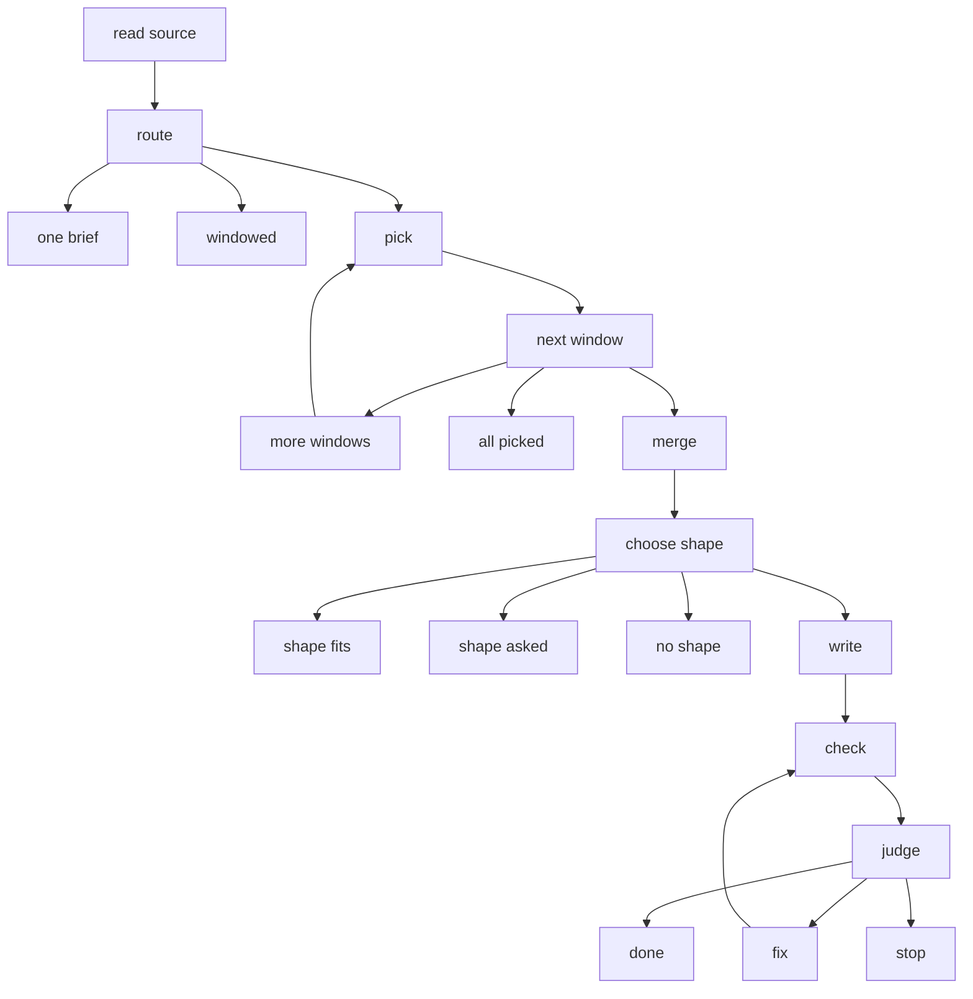

# story/ — a conversation to a checked storyboard, as a chart

**Why:** a long conversation does not fit in one brief, and a board with one wrong number should not be written again
whole. This chart reads the conversation once, window by window, writes the board from the points it picked and the
messages they cite, and sends back one piece at a time until the board reads. Its record says why each choice was made.

```js
import {storyFromConversation, inProcess} from 'footprint-storyreel/storyboard/story';

const result = await storyFromConversation({
  conversation: {file: 'chat.json'},              // or {messages: [{id, who?, text}]}
  model: inProcess(async (brief) => myModel(brief.instructions, brief.material)),   // JSON text back
});
result.board;      // the read storyboard, or null when the run stopped (result.stopped says where and why)
result.standing;   // per scene: {standing: 'known' | 'not-sure' | 'ask', why, sources, point}
result.ask;        // what only the owner can answer; the run does not stop for it
result.record;     // {narrative, snapshot}: route, shape, fixes and every decide() with its evidence
```

Options: `shape` (ask for one), `drawable` (the shapes the drawer draws; a film's by default), `window` (bytes, 96 KB by
default), `mostFix` (fix rounds, 3 by default), `cwd` (the project a file is read in).

## The chart

Drawn by `toMermaid()` from the real chart (`storyMermaid()`); a test fails when this drawing and the chart differ.



| folder | stage | asks the model |
|---|---|---|
| `read-source/` | the conversation opened: counts, bytes, a hash, windows | no |
| `route/` | one brief or windowed, by `decide()` on the window count | no |
| `pick/` | points per window, looped with `loopTo`; the decider `next window` | yes, retried as a policy |
| `merge/` | one list; a disagreement marked `ask` | no |
| `choose-shape/` | `decide()` on the drawable shapes the points fill | only when two or more fit |
| `write/` | the board from the points and cited messages | yes, retried as a policy |
| `check/` | the existing readers, then the judge's `decide()`: done, fix, stop | no |
| `fix/` | one brief per piece at fault, then back to check; at most `mostFix` rounds | yes, retried as a policy |
| `done/` | the board read, a standing per scene, the asks | no |

`chart.mjs` is the wiring, as data. `engine.mjs` is the one module that calls footprintjs. `port/` is the model's port.

## The port

Every stage that asks sends the same shape, `{stage, instructions, material, expects, ids}`, and takes JSON text back.
`instructions` are code's words, the same whatever the conversation says; `material` is data lines. A driver is
`{answer(brief, at)}`, where `at` is `{stage}` and nothing more: a driver never holds the chart's scope. `inProcess(fn)`
awaits the app's own call. A paused driver answers the same briefs from outside the run through the same method (see
`port/README.md` for how it pauses without the scope), so adding it does not change the port.

## What it does not do yet

- **Disagreements across windows are not found.** Each message is in one window and a point cites only its own window,
  so the merge removes duplicates and marks disagreements within a window only. Two windows that disagree keep both points,
  each standing on its own messages.
- **At most 200 windows a run** (`MOST_WINDOWS`): a longer conversation is refused, naming the larger window that fits it.

## Threats

A conversation is untrusted, and so is what a model writes. Words stay data; the chart's state, and so its record, holds
counts, bytes, a hash, window offsets and message ordinals (a message's place in the conversation), never words and never
a message's id (an id is text the conversation chose; the caller gets ids back on the result, from working memory). Every
refusal is fixed words: at the stage boundary (`engine.mjs`), anything that is not one of the chart's own refusals becomes
"the <stage> stage failed", its own error kept aside and handed to the caller as `cause` once the record is taken. Each
folder's README names its own threats. `test/story/threats.test.mjs` checks the main ones: no message or answer words, and
no message ids, in the record; nothing quoted on the error path (a file that is not JSON, a huge id on a bad message, a
stage's own failure); a planted instruction changes no instructions; every brief bounded; the record bounded at 200 windows.

Tests: one file per stage folder in `test/story/` (`read-source.test.mjs`, `pick.test.mjs`, …), with a scripted fake model
(`fakes.test.mjs`); `test/story.test.mjs` loads them into the suite.
